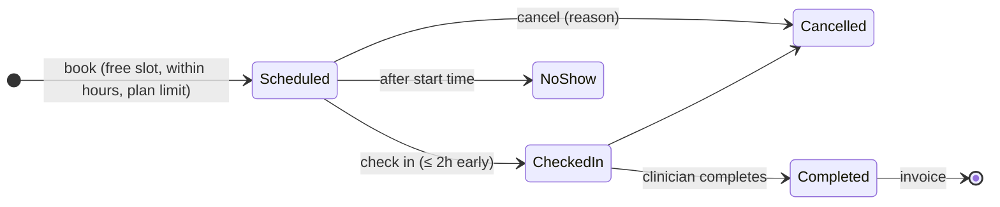

# ClinicDesk

[](https://github.com/talhazubairasim/clinicdesk/actions/workflows/ci.yml)

A **multi-tenant SaaS** for clinics: each clinic signs up, invites its team, sets practitioners'
working hours, books patients into free slots, runs the visit (check-in → complete), and
invoices and takes payment. Plans (Free / Pro / Enterprise) limit usage and are billed monthly.

**.NET 8 minimal APIs · EF Core · PostgreSQL · React + TypeScript · Docker · Kubernetes**

## What makes it interesting

| | |
|---|---|
| **Tenant isolation** | Every clinic-owned table carries `TenantId`. EF Core global query filters scope every query to the tenant in the JWT, and `SaveChanges` stamps new rows and refuses to write another tenant's data. Tests prove clinic B can't read, book or modify clinic A's records. |
| **No double booking, even under load** | Booking checks overlaps first for a friendly error, but the real guarantee is a Postgres **exclusion constraint** (`EXCLUDE USING gist (practitioner WITH =, tstzrange(start, end) WITH &&)`). A test fires 8 concurrent bookings at one slot: exactly one wins, seven get `409`. |
| **Time zones** | Working hours are stored in clinic-local time; slots are generated per local day and stored in UTC, so a clinic in `Asia/Karachi` sees 09:00 as 09:00. |
| **Subscriptions** | Plan limits (practitioners, appointments per month) return `402 Payment Required`. Upgrades are charged pro rata; downgrades are blocked if usage exceeds the new plan; a billing job renews each period or marks the clinic past due. |
| **Roles** | Owner / Admin / Practitioner / Receptionist, enforced by authorization policies: front desk books and bills, clinicians complete visits, admins manage plan and team. |
| **Background jobs** | Appointment reminders are emailed 24 hours ahead (once), and subscriptions renew. Jobs take a `TimeProvider`, so tests drive them with a fake clock. |
| **Audit trail** | Every insert, update and delete of clinic data is recorded with user and time. |
| **Real-database tests** | API tests run against Postgres 16 in **Testcontainers**, not an in-memory fake, so the constraint, `jsonb` columns and `xmin` concurrency tokens are exercised for real. |

## Domain



Invoices: **Draft** (editable) → **Issued** (emailed, due date) → **Partially paid** → **Paid**, or **Void**
if nothing has been paid. Totals, tax (rounded to cents) and balances are computed in the domain.

## Run it

```bash
docker compose up --build
```

| | |
|---|---|
| App | http://localhost:3000, clinic **demo**, `demo@clinicdesk.dev` / `Demo#2025` |
| API + Swagger | http://localhost:5200/swagger |
| MailHog (reminders, invoices) | http://localhost:8025 |

The demo clinic has two practitioners, four patients and upcoming bookings. Other seeded logins
(same password): `frontdesk@clinicdesk.dev` (receptionist) and `dr.raza@clinicdesk.dev` (practitioner).
Or sign up your own clinic at `/signup`.

`./scripts/e2e.sh` drives the running stack: signs up a clinic, checks isolation from the demo
clinic, books and double-books, completes a visit, invoices it, takes two payments, then hits and
lifts the Free plan limit.

## Tests

```bash
dotnet test                       # domain unit tests + API tests on Postgres (needs Docker)
cd web && npm install && npm test # React pages with Vitest + Testing Library
```

CI runs both, then boots the whole stack with Docker Compose and runs the end-to-end script.

## Layout

```
src/ClinicDesk.Domain   Entities and rules: Tenant/plans, Practitioner hours, Schedule (slots),
                        Appointment lifecycle, Invoice maths. No framework dependencies.
src/ClinicDesk.Api      Minimal API endpoints per feature, EF Core (tenant filters, audit),
                        JWT auth and policies, FluentValidation, background jobs, demo seed
tests/                  Domain unit tests; API integration tests with Testcontainers
web/                    React 18 + Vite + Tailwind app
deploy/k8s              Postgres StatefulSet, API and web Deployments, Ingress
```
